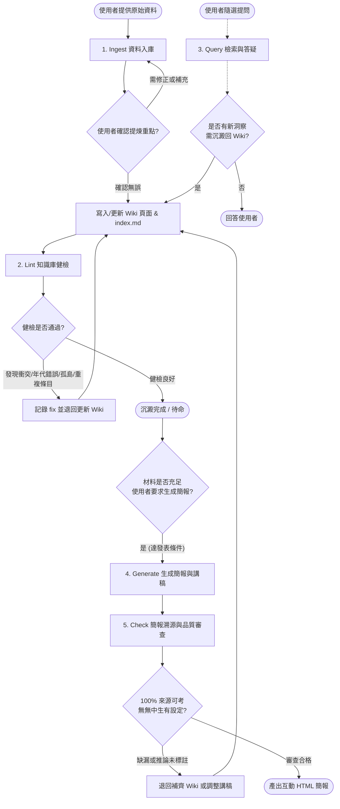

# 《原神》LLM Wiki & 教學簡報系統維護手冊 (AGENTS.md)

本文件是此專案中所有 AI 代理人（LLM Agent）的最高行為準則與系統憲法。
本專案採用 Andrej Karpathy 的 **LLM Wiki 模式**，旨在將《原神》（Genshin Impact）龐大散落的文本沈澱為一套具備持續複利、高度結構化、交叉互連的知識庫，並以此為基礎產出高品質的教學型 HTML 簡報。

---

## 1. 核心理念與三層架構

Wiki 不是傳統的暫時性 RAG，而是一個**持續累積、長久存續的知識代碼庫（Compounding Knowledge Base）**。
- **使用者（Human）**：負責提供素材來源、提出好問題、在關鍵更新節點進行審查與決策。
- **代理人（LLM）**：負責所有的繁瑣整理——閱讀歸納、多頁交叉引用、消除或標註矛盾、維護目錄與日誌、生成教學簡報。

```text
Genshin-LLM-Wiki/
├── raw/                         # 【第一層：不可竄改的原始資料層 (Raw Sources)】
│   ├── 01-mondstadt/            # 依玩家遊玩順序與國度劃分
│   ├── 02-liyue/
│   └── ...
│
├── wiki/                        # 【第二層：知識沉澱層 (The Wiki Layer)】
│   ├── regions/                 # 國度歷史、地理區域、各卷章節劇情
│   ├── entities/                # 人物（角色/神明/魔神）、組織、勢力（單一唯一實體頁）
│   ├── cosmology/               # 宏觀宇宙觀（天理、深淵、光界/虛界/人界、原初等）
│   └── timeline/                # 跨時期歷史年表（年代錨點與重大歷史事件）
│
├── presentations/               # 【第三層：教學產出層 (Presentations)】
│   ├── scripts/                 # 教學講稿大綱與結構化腳本 (Markdown)
│   └── html/                    # 現代單檔案互動式 HTML 投影片 (Standalone HTML)
│
├── assets/                      # 圖片資源庫（供 HTML 簡報引用，唯讀）
├── index.md                     # 內容目錄（按分類組織的全局頁面索引）
├── log.md                       # 時間軸操作日誌（Append-only 紀錄）
└── AGENTS.md                    # 本規範文件
```

---

## 2. 核心閉環工作流 (The Compounding Loop & Graph)

本知識庫的工作流程以「資料沉澱」與「即時檢查」為核心。Query（答疑檢索）可依使用者需求隨時發起，而 Lint（知識庫健檢）則在每次 Wiki 更新（CommitWiki）後進行必要的健康檢查：



### 各節點規則與退回機制（Fallback Rules）
1. **Ingest（資料入庫）**：
   - 提取原文核心要點，預計受影響的 3～10 個 Wiki 條目清單。
   - **檢查點**：若使用者指出重點偏移或有其他考據視角，退回重整提綱再行寫入。
2. **CommitWiki（寫入與更新）**：
   - 嚴格檢查別名與實體對應，禁止新增重複條目。
   - 同步更新 `index.md` 與 `log.md`。
3. **Lint（知識庫健檢）**：
   - **觸發時機**：每次 CommitWiki 後自動執行，或由使用者手動觸發。
   - 檢查項目：年代錨點衝突、古蒙德與舊蒙德混淆、世界樹竄改前後矛盾、孤島頁面、實體重複。
   - **退回處理**：若發現問題，在 `log.md` 記為 `fix`，退回更新對應頁面直到通過。
4. **Query（隨選檢索與答疑）**：
   - 依照使用者需求隨時啟動，查閱 `index.md` 與特定 Wiki 頁面回答。若產出有比較價值的新結構，提示沉澱回 Wiki。
5. **Generate & Check（教學簡報生成與溯源審查）**：
   - **零幻覺準則（Zero Hallucination）**：簡報每頁的核心論點必須能完全對應到 `wiki/` 或 `raw/` 來源。若審查不通過，退回重新編寫或先回補 Wiki。

---

## 3. 史料可信度與歷史時代劃分（Epistemology）

### 3.1 客觀事實 vs 待解推論 結構化切分
所有條目必須客觀嚴謹，嚴禁把未經驗證的推測直接當成定論：
1. **官方明文記載（定論）**：遊戲內有確切文本、主線實證、角色語音直接證實的既成事實。
2. **待解謎團與學術推論（假說）**：社群考據、學者假設、象徵隱喻，或尚未在主線回收的伏筆。若年代或事件未在原文中精確寫明，必須標明為「推估」或「待考證」。

### 3.2 出處與敘事視角溯源（Provenance）
記錄關鍵資訊時，必須使用 GitHub 樣式 Alert 標註來源與講述者立場，避免將角色主觀陳述視為宇宙客觀真理：
```markdown
> [!NOTE] 記載出處與敘事視角
> - **文獻出處**：書籍《溫妮莎傳奇》上卷 / 武器素材《高塔孤王的破瓦》
> - **敘事者立場**：詩人傳唱敘事 / 官方客觀物品解說。
```

### 3.3 蒙德歷史時代嚴格區分（關鍵修正）
必須明確區分「古蒙德時期」與「舊蒙德貴族統治時期」，切勿混為一談：
- **古蒙德時期（約 2600 年前）**：
  - 核心特徵：烈風之魔神「高塔孤王」迭卡拉庇安統治暴風之城（即現在的風龍廢墟），與「北風狼王」安德留斯在冰雪中抗衡。
  - 終結標誌：無名少年、精靈巴巴托斯、古恩希爾德家族與紅髮騎士聯手起義，孤王隕落。精靈凝聚神格成為風神巴巴托斯，吹散風雪，重塑蒙德地形。
- **舊蒙德貴族統治時期（約 1000 年前）**：
  - 核心特徵：新蒙德城建立數百年後，當初的開國貴族（勞倫斯氏族、古恩希爾德氏族、伊蒙洛卡氏族）中，以勞倫斯為首的統治階級逐漸腐化墮落，實施殘暴的奴隸制統治。
  - 終結標誌：角鬥士溫妮莎起義，風神巴巴托斯甦醒協助，擊潰貴族統治，創立西風騎士團與四風守護體制。
- **其他標準時代錨點**：
  - **原初時代 / 葬火之年**：原初之人降臨、七龍王統治、提瓦特創世神話。
  - **魔神戰爭時期（約 3700 ~ 2000 年前）**：全提瓦特魔神混戰，七神座席確立。
  - **坎瑞亞災變時期（約 500 年前）**：坎瑞亞覆滅、漆黑魔獸入侵、特瓦林迎戰毒龍杜林。
  - **當前時代（旅行者甦醒後）**：愚人眾行動、四風守護甦醒、特瓦林危機。

---

## 4. 單一實體唯一性與別名規範（Entity Canonicalization）

為避免建立重複頁面（例如分別建立「溫迪.md」與「巴巴托斯.md」）：
1. **單一實體唯一主頁原則**：
   - 具備多重身分或稱號的人物/神明，**僅建立一個唯一的 canonical Markdown 檔案**（通常以本名、真名或神名為準，例如 `wiki/entities/巴巴托斯.md`）。
2. **YAML Aliases 繁簡英全覆蓋**：
   - 在該唯一條目的 YAML Frontmatter 中，完整宣告所有可能被引用的別稱：
     ```yaml
     ---
     title: "巴巴托斯"
     type: "entity"
     category: "archon"
     aliases:
       - "溫迪"
       - "温迪"
       - "Venti"
       - "Barbatos"
       - "風神"
       - "吟遊詩人"
     region: "mondstadt"
     era: "ancient / modern"
     sources:
       - "raw/01-mondstadt/01-biography-of-gunnhildr.md"
     last_updated: "2026-11-23"
     ---
     ```
3. **雙向連結引用規範**：
   - 在內文中提到該角色日常化身時，使用別名連結語法：`[[巴巴托斯|溫迪]]` 或 `[[巴巴托斯|風神]]`。
   - **嚴格禁止**為同一個人物建立第二個重複檔案。

---

## 5. 日誌記錄標準 (`log.md`)

`log.md` 採嚴格的追加格式（Append-only），統一記錄以下操作類別：

- `## [YYYY-MM-DD] ingest | 文獻標題`：記錄新資料入庫，列出更動與新建的頁面。
- `## [YYYY-MM-DD] query | 查詢主題`：記錄具備重要綜合分析價值的答疑，並註明是否沉澱回 Wiki。
- `## [YYYY-MM-DD] lint | 健檢項目`：記錄全面檢查之發現（無問題或發現待修項目）。
- `## [YYYY-MM-DD] check | 簡報審查結果`：記錄簡報或條目的溯源驗證結果（Pass 或 Fail 說明）。
- `## [YYYY-MM-DD] fix | 修正說明`：記錄因衝突、年代偏誤、實體重複或無來源敘述所進行的修正。
- `## [YYYY-MM-DD] generate | 簡報產出`：記錄生成 HTML 投影片與對應的 Wiki 出處。

---

## 6. HTML 簡報生成與溯源政策（Presentation Policy）

未來生成 HTML 教學簡報時，必須恪守以下規範：
1. **嚴格對應出處**：
   - 投影片每一頁講述的重大歷史事件或角色設定，必須在備註或頁面上標註 `[[Wiki 條目]]` 與 `raw/` 來源。
   - 不得收錄未經 Wiki 沉澱、無原始資料支持的二創或腦補內容。
2. **格式與視覺設計**：
   - 採單檔案（Standalone）現代 HTML，內嵌 CSS 與 JS，支援 $\leftarrow$ / $\rightarrow$ / 空白鍵換頁。
   - 引用 `assets/` 中的圖像檔案（例如 ``）。
   - 設計風格契合提瓦特幻想 UI，文字主次分明，適合教學演講。

---

## 7. 標準頁面範本（Page Templates）

所有範本的 YAML Frontmatter 皆經過 Obsidian 相容性校驗，支援雙引號字串與標準陣列格式：

### 實體頁面範本 (`wiki/entities/`)
```markdown
---
title: "實體全名"
type: "entity"
category: "character" # character / archon / organization / monster
aliases:
  - "英文名稱"
  - "簡體名稱"
  - "其他別稱或稱號"
region: "mondstadt"
era: "ancient" # ancient / aristocracy / cataclysm / modern
sources:
  - "raw/01-mondstadt/source-file.md"
last_updated: "2026-11-23"
---

# 實體全名

## 1. 概況簡介
[一句話定位該實體在提瓦特世界觀中的角色與地位]

## 2. 官方明文記載
[歷史生平、職責、核心事件，按時間軸編排，附帶 [[雙向連結]]]

## 3. 待解謎團與學術推論
[社群考據、未證實之關聯、象徵隱喻]

> [!NOTE] 記載出處與敘事視角
> - 出處：[文獻名/任務名]
> - 視角：[主觀敘事者/客觀記述]

## 4. 相關連結
- 相關地區：[[所屬區域]]
- 相關歷史：[[歷史事件]]
- 相關人物：[[人物]]
```

### 國度與章節範本 (`wiki/regions/`)
```markdown
---
title: "國度名稱"
type: "region"
aliases:
  - "英文名稱"
  - "別稱如風之國"
archon: "[[守護神明條目]]"
element: "風"
ideology: "自由"
last_updated: "2026-11-23"
---

# 國度名稱

## 1. 國度概況與理念
## 2. 地理環境與重要聚落
## 3. 歷史脈絡（由古至今）
### 3.1 遠古與古蒙德時期（約 2600 年前）
### 3.2 舊蒙德貴族統治與起義時期（約 1000 年前）
### 3.3 災變與近代體制（500 年前至今）
## 4. 主線章節劇情索引
## 5. 待解謎團與地脈異象
```

---

## 8. 第一階段里程碑（蒙德篇）
- **主題**：蒙德（風之國）起步篇
- **執行策略**：依玩家初入蒙德體驗，由淺入深收錄至少 5 篇核心原始資料至 `raw/01-mondstadt/`。
- **嚴格守則**：完成 5 篇核心原始資料入庫與 Wiki 沉澱前，**不進行任何 HTML 簡報生成**。
